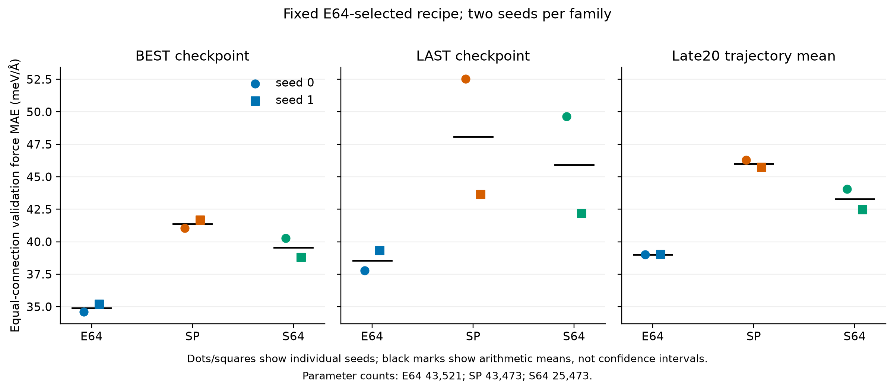
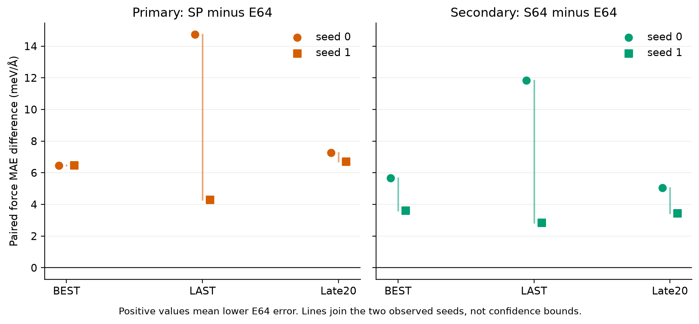
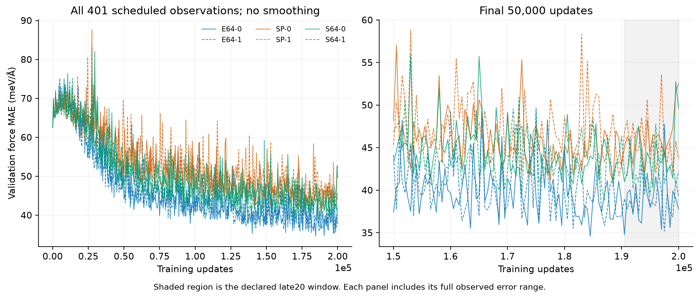

# Representation-study closeout

26 October 2026. Status: accepted by independent scientific and engineering saved-result reviews.

## Finding and scope

E64 has lower observed validation force error than both scalar controls at BEST, LAST and late20, for both seeds under the E64-selected recipe. This supports a descriptive fixed-recipe finding. It does not establish symmetry causality, recovery improvement, best-in-family performance or held-out generalization.

We audited six completed fits and their cached outputs. E64 reuses the two accepted energy-baseline fits; SP and S64 each contain two new scalar fits. No trained model was restored or queried, and no new fitting, relaxation or test evaluation ran.

## Original protocol

E64 uses width-64 scalar/vector graph features. SP uses width-88 scalar features to approximate its parameter count; S64 uses width-64 scalar features as the same-width control. All forces are gradients of invariant energies, so every arm retains force rotation symmetry.

SP has 48 fewer parameters than E64, a 0.1103% gap. The saved shape-only search selects width 88 mechanically from widths 8–256. Parameter matching and width matching answer different questions; they do not isolate the causal effect of vector features.

All fits use 200,000 Adam updates, batch size four and learning rate 0.003. The common backbone has two interactions, eight radial functions and a 5 Å cutoff. E64-selected loss weights and remaining settings are retained without scalar-specific retuning.

The study has 4,891 training records from 26 connections and 974 validation records from five connections. The literal validation groups are 13, 18, 18_2, 66 and 78. This closeout reads only validation numerical arrays; it preserves the original split and training-derived normalization.

## Error summaries

Force errors are equal-connection MAE in meV/Å. BEST is the first minimum among 401 scheduled checks; LAST is update 200,000. Late20 averages the 20 checks at updates 190,500–200,000 and is a trajectory summary, not another selected checkpoint.

| Family | Parameters | Mean BEST | Mean LAST | Mean late20 |
|---|---:|---:|---:|---:|
| E64 | 43,521 | 34.893 | 38.565 | 39.019 |
| SP | 43,473 | 41.358 | 48.084 | 46.010 |
| S64 | 25,473 | 39.542 | 45.913 | 43.267 |

SP minus E64 is the primary paired contrast; S64 minus E64 is secondary. Positive differences favor E64. Both seeds give positive differences under all three summary definitions.

| Contrast | Mean BEST difference | Mean LAST difference | Mean late20 difference |
|---|---:|---:|---:|
| SP minus E64 | 6.465 | 9.519 | 6.991 |
| S64 minus E64 | 4.649 | 7.348 | 4.248 |

Figure 1. Individual seeds and arithmetic means. Markers show observed seed variation, without confidence bounds. The late20 ordering agrees with BEST, so this descriptive ordering persists beyond the selected minimum.

| Run | BEST update | BEST | LAST | late20 |
|---|---:|---:|---:|---:|
| E64-0 | 184,500 | 34.587 | 37.791 | 39.008 |
| E64-1 | 197,500 | 35.198 | 39.340 | 39.029 |
| SP-0 | 188,500 | 41.046 | 52.522 | 46.276 |
| SP-1 | 189,500 | 41.669 | 43.647 | 45.743 |
| S64-0 | 195,500 | 40.264 | 49.632 | 44.062 |
| S64-1 | 187,000 | 38.820 | 42.195 | 42.471 |

Figure 2. Scalar-minus-E64 differences paired by seed. These pairs reuse the same validation connections and are not independent datasets.

At connection level, SP has higher error in all ten seed-by-connection cells at both BEST and LAST. S64 has higher error in all ten BEST cells and nine LAST cells. The remaining LAST cell favors S64 by 2.391 meV/Å; the aggregate ordering is not uniform across every endpoint comparison.

## Other endpoint metrics

The following two-seed means are measured at BEST. Pooled force metrics weight all Cartesian components. Equal-connection MAE averages within each connection before averaging connections. Force columns use meV/Å; energy uses meV per molecule.

| Family | Pooled force MAE | Cartesian force RMSE | Energy MAE |
|---|---:|---:|---:|
| E64 | 34.873 | 55.508 | 128.725 |
| SP | 41.258 | 78.856 | 142.536 |
| S64 | 39.531 | 74.797 | 155.971 |

Complete BEST/LAST reductions and per-connection differences accompany the report. Energy and RMSE were not rescored at intermediate checkpoints; no late20 energy or RMSE result is claimed.

## Trajectories and selection

Figure 3. All 401 scheduled observations without smoothing, plus the final 50,000 updates. Each panel includes its full observed range; shading identifies the declared late20 window.

BEST selects the minimum on the same validation connections used for reporting. The histories fluctuate, and each LAST error exceeds its corresponding BEST error. Co-reporting LAST and late20 reduces reliance on one selected minimum, but does not create independent validation or establish convergence.

## Recorded CPU training time

The table gives arithmetic means across the two retained fits per family. Whole-fit elapsed includes bookkeeping and persistence; compiled update timing has a narrower scope. E64 was trained earlier and reused, so these values are observational timing context rather than a controlled efficiency or inference-speed comparison.

| Family | Whole-fit seconds | Compilation seconds | Warmup seconds | Validation seconds | Compiled update milliseconds |
|---|---:|---:|---:|---:|---:|
| E64 | 4489.776 | 1.506 | 0.031 | 433.891 | 12.535 |
| SP | 1960.730 | 1.265 | 0.008 | 87.489 | 1.967 |
| S64 | 1837.065 | 1.208 | 0.008 | 71.279 | 1.549 |

The [recorded publication interruption](evidence/2026-10-21/representation-publication-recovery.json) happened after SP-0 numerical completion. Its retained outputs were verified and skipped on queue restart. This was an operational publication failure rather than a failed fit; all four scalar fits completed their declared budgets.

## Verification and reproducibility

The audit authenticated 92 files, six completed runs, twelve endpoint prediction files and twelve historical reload proofs. It checked 2,406 history observations and independently reduced 736,344 cached force components. The largest scalar metric discrepancy was 1.388e-17; the largest history-summary discrepancy was 6.939e-18.

Acceptance used absolute tolerance 1e-14 plus relative tolerance 1e-12. All inventoried inputs were unchanged afterward. Checkpoint envelopes, control histories and opaque BEST bindings were checked without restoring model payloads. Historical reload proofs were authenticated; actual model loading was not repeated.

The focused audit and relevant regression suite passed 38 tests. Implementation review found five missing recipe/header guards; failing tests reproduced them, and the corrected suite passed. Initial REDs, review corrections and invocation failures remain retained locally.

The closeout environment reports Python 3.12.16, NumPy 2.5.3, msgpack 1.2.3 and Matplotlib 3.11.2. Retained training provenance records Python 3.12.13. This saved-array arithmetic audit does not establish checkpoint-load portability; future model admission must check its runtime again.

See the [analysis JSON](representation-closeout-2026-10-26/analysis.json), [run table](representation-closeout-2026-10-26/run_metrics.csv), [paired table](representation-closeout-2026-10-26/paired_seed_deltas.csv), [connection table](representation-closeout-2026-10-26/connection_deltas.csv) and [reproduction notes](representation-closeout-2026-10-26/README.md). Editable [audit](../scripts/close_representation_study.py) and [plotting](../scripts/plot_representation_closeout.py) sources accompany PNG/PDF figures.

## Interpretation and next step

The evidence supports lower observed E64 force error under this specific recipe, at similar parameter count and matched feature width. Scalar-specific tuning, more seeds and independent evaluation could change the broader comparison. Two seeds and five reused connections support descriptive findings, without population-level superiority or causal attribution to vector features.

This study adds no recovery result and leaves the original failed recovery adequacy gate unchanged. Idris retains MACE loading/parity, Olufunke retains evaluator integration, and Aaron retains standalone physical/inference-cost analysis. Both independent saved-result reviews accept this bounded closeout. These findings and editable artifacts are ready for the final report and reproducibility release.
