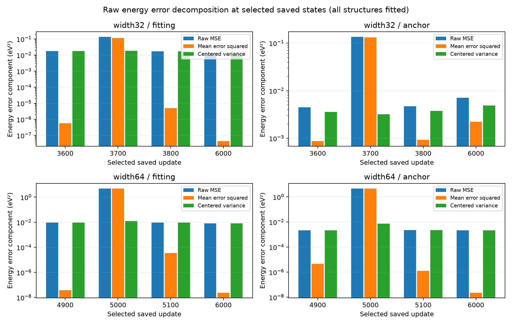

# Capacity spikes: paper-facing findings from saved states

We restored eight states from the completed aspirin capacity comparison and evaluated their predictions and scaled energy/force derivatives without taking a training step. Both arms passed the diagnostic verification rules, and source parameters, optimizer state and checkpoint bytes remained unchanged. The diagnostic took 36.18193837499712 seconds within its 1800-second total cap. Independent saved-result review passed; its scope and artifact identities are recorded in the closeout entry below. The exact reviewed draft is retained separately.

The original capacity comparison still failed the joint fitting target in both arms. At update6000, width32 retained energy/force baseline fractions0.3194094334870974/0.4657052724792342, while width64 retained0.2118608476964685/0.5639486501605391. This diagnostic adds an explanation of the error composition at selected saved states. It supplies no improved trained model, revised acceptance gate or held-out result.

## What the energy residuals show

For signed energy error e=prediction−target, we used the population identity MSE(e)=mean(e)²+mean((e−mean(e))²). The second term is the centered error variance. It includes differences across groups; it is not the average of within-group variances. All values below use the128 fitting structures and remain in physical energy units.

| Saved state | Raw energy MSE (eV²) | Signed mean error (eV) | Squared mean error (eV²) | Centered variance (eV²) | Squared-mean share |
|---|---:|---:|---:|---:|---:|
| width32 u3600 | 0.0179763639690202 | 0.000760418044622846 | 5.78235602588033e-07 | 0.0179757857334176 | 0.00321664383% |
| width32 u3700 | 0.135137953385881 | -0.341234528197116 | 0.116441003233908 | 0.0186969501519724 | 86.1645454% |
| width32 u3800 | 0.0173033360209381 | 0.00223942245005901 | 5.01501290982829e-06 | 0.0172983210080283 | 0.028982925% |
| width64 u4900 | 0.00955538949606285 | -0.000193030934427359 | 3.72609416458993e-08 | 0.00955535223512121 | 0.000389946864% |
| width64 u5000 | 4.88250678443078 | 2.20681145976273 | 4.87001681894012 | 0.0124899654906646 | 99.7441895% |
| width64 u5100 | 0.00932241419185751 | -0.00590346168442569 | 3.48508598594822e-05 | 0.00928756333199803 | 0.373839428% |

The squared mean accounts for99.38447026696703% of the fitting MSE increase from u3600 to u3700, and99.93977749791236% from u4900 to u5000. So nearly all of each measured increase is a common energy offset, although width32 still has a substantial centered error at its peak. The wider model's fitting centered variance increases by30.711722% while its mean energy error reaches+2.20681146eV. We should preserve that smaller change as well; an offset-dominated spike does not imply perfectly unchanged relative-energy errors.

Also, the16 fitted anchors show the same broad pattern: their peak squared-mean shares are97.64070808450951% and99.84186040046685% for width32/64. Their pre-to-peak increase shares are100.30167486961181% and99.88849058877043%. The first share exceeds100% because anchor centered variance falls while squared mean rises. These signed decomposition shares are deliberately not clipped. Anchors are a subset of the fitting structures, so this is a second aggregation of fitted data, not an independent generalization test.

At u6000, the fitting signed mean errors are+0.00021192289768029449eV and−0.00015582647317679416eV, and squared-mean shares are0.0003747853911407392% and0.00030549661507039164%. Their raw fitting MSE values remain0.0119832084235 and0.00794833348223eV². The final fitting energy errors therefore mostly reflect centered residuals. Removing a constant energy offset at these endpoints would not resolve the failed joint fitting gates.

## What the derivatives show

We retained the original fixed scaled-loss weights, energy0.014584365670390719 and force1.9854156343296092. Whole-parameter weighted gradient norms at the peaks are56.945143160530414/17.09925361395206 for width32 energy/force and624.6571621174454/139.61591494066224 for width64. The energy-to-force ratios are3.330270691702372 and4.4741114391072765. Both components grow sharply relative to the preceding saved state; the energy norm grows166.77995173809643-fold and1154.1055559578751-fold, while the force norm grows38.546889377194354-fold and247.4509045786981-fold.

The backbone energy/force cosine changes from−0.8505316385904642 to+0.6557963389656083 at the width32 peak, and from−0.951607681471604 to+0.7010270670585239 at the width64 peak. The whole-parameter peak cosines are+0.6539359584359904 and+0.6990803907076464; head-kernel peak cosines are+0.6669436522612661 and+0.6306152003206111. From these observations, an explanation that assumes instantaneous energy/force gradient opposition at every spike would be incomplete. Both scaled objective slopes along the negative weighted joint Euclidean gradient are negative at the two peaks. These are local mathematical directions, not the historical Adam update directions, and a positive cosine at a saved peak does not reveal the preceding cause of that peak.

The shared energy-head bias is per atom. For aspirin's21 atoms its unweighted scaled energy derivative is2 mean(21e)/s_E², while its force derivative is zero. All eight analytic checks agree with the stored autodiff values; the peak weighted energy bias derivatives are−4.4866933224866 and+29.016073762573132. A constant atomic bias therefore offers a coordinate-independent energy adjustment. However, most peak energy gradient norm lies in the backbone (55.82534515168657 and618.6991388992897), and the offset observed in predictions need not have been created by a bias-only parameter update. We did not compare every intervening parameter update or reconstruct optimizer trajectories.

Fitting force MSE is0.007776068662395142 before and0.007767711452637091 at the width32 peak; width64 changes from0.008461949627994764 to0.010254620466342844eV²/Ų. This distinguishes the much larger energy spike from its simultaneous force-error behavior. We should not infer derivative magnitude directly from the force MSE alone.

## Verification, negative checks and limits

Both independent joint-gradient identities, scaled-loss identities, historical score reconciliations and state-integrity checks pass for all eight cases. The u6000 predictions also match the original saved reference arrays within the fixed absolute tolerance1e−10. There are72 prediction calls with1152 role entries,256 gradient calls with4096 structure exposures and512 finite-difference vector-objective calls with8192 exposures. Each vector call computes both losses on the same support; exposures are not doubled for that reason. The144 role entries per state contain128 unique structures. Training updates, random parameter initializations and optimizer proposals are all zero.

Thirty of32 individual finite-difference steps pass. At width64 u5100, the energy h=1e−4 step has absolute error0.012876678739630165 and fails; at width64 u6000, the force h=1e−4 step has absolute error0.000031798494105783615 and fails. Their h=1e−5 errors are0.0001287669712155548 and0.0000003179797993246858, which pass. All16 case/objective checks satisfy the rule fixed before execution: at least one of the two retained steps must agree under absolute tolerance1e−8 and relative tolerance1e−4. No step, tolerance or case selection was changed after seeing results. Directional checks do not validate every derivative component. Saved-only review can inspect retained estimates and criteria; it does not independently reevaluate all finite-difference objective vectors.

Peak states were chosen retrospectively as each arm's maximum saved fitting energy MSE, with immediately adjacent saved observations and endpoint controls. Updates are not aligned between widths, and the100-update observation gaps do not establish spike duration, recovery path or continuous stability. All structures were fitted, one seed/rate is represented, and width changes parameterization and optimization geometry. This remains a diagnostic observation rather than evidence for the project's main landscape hypothesis.

The saved-only packaging attempt initially failed because macOS's unresolved temporary /var path violates the artifact writer's symlink guard. Resolving that path repaired packaging without numerical work. Both failed logs are retained. Font-cache warnings occurred during the successful figure export; the exported image was visually checked. The initial interrupted test suite and all earlier review/engineering failures remain in the evidence log and execution records, alongside the final615-test pass.

## Figure and sources

Figure: Raw energy MSE, squared mean energy residual and population centered residual variance at the selected saved states. Panels use logarithmic vertical axes with separate ranges. Bars show discrete observations without interpolation. Anchor structures were also fitted. Direct numerical comparisons across panels should use the canonical values, not apparent bar heights.

Canonical numerical authority: [diagnostic JSON](capacity-spike-diagnostics.json), [readable report](capacity-spike-diagnostics.md), [capacity comparison](capacity-diagnostics.json). Complete case/group/leaf-level details remain in the diagnostic JSON and raw prediction/gradient artifacts; compact extracted values are in[paper metrics](execution/spike-diagnostic-2026-10-02/paper-metrics.json). The new raw archive has247 members with CRC and every archived byte hash verified; original343 raw files and347 diagnostic source pins are preserved. Exact source, review, launch, inventory and archive hashes are in the retained execution records.

## Next candidate, unexecuted

A controlled trial separating energy-offset handling from force-sensitive optimization is now worth designing, with the unchanged width32 setup as its reference. It should retain raw energy/force metrics and the original joint gate, record energy mean/variance through training, and test whether analytical offset handling reduces these excursions without harming force fitting. That trial needs a concrete protocol and two independent plan reviews before implementation. Offset handling alone is not expected to repair the endpoint force failure, since a coordinate-independent bias cannot change forces and the endpoint energy offset is already tiny. The full training pilot remains pending.

## Independent saved-result closeout

Independent saved-only result reviewPASS is recorded inthe review (historical record retained separately). It independently recomputed residual/group statistics, saved-gradient geometry and identities, atomic bias checks, baseline fractions and both increment directions, reconciled state/history/reference/work/cap records, rebuilt canonical reports byte-for-byte and verified both raw archives. No model calls or training were repeated. The review explicitly retains the two failed larger FDsteps and limits its finite-difference audit to saved directional derivatives and criteria, since every central objective vector was not retained. Source implementation checkpoint:b013acdae3f4566a8b41d7b417bf43ebe7583c5f; canonicalJSON SHA-256:0e3a6f797effe68b63f9c3321141a9374062f69fc9f767b6853b0e70b2bdfc7c; raw247-member archive SHA-256:d814f9d4db37f17c9af0f125b15a4ac986cb6aa9aa633c5191cbda10fc11a47f.

Historical source hashes identify the original research artifacts. Raw run archives, original launch packages and historical audit records referenced here are retained separately; this report is a research export. See [the reproduction note](../docs/REPRODUCTION.md).
