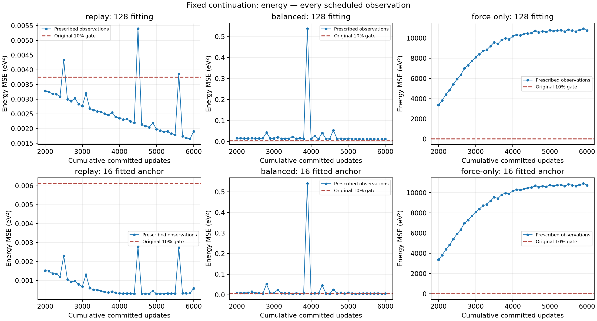
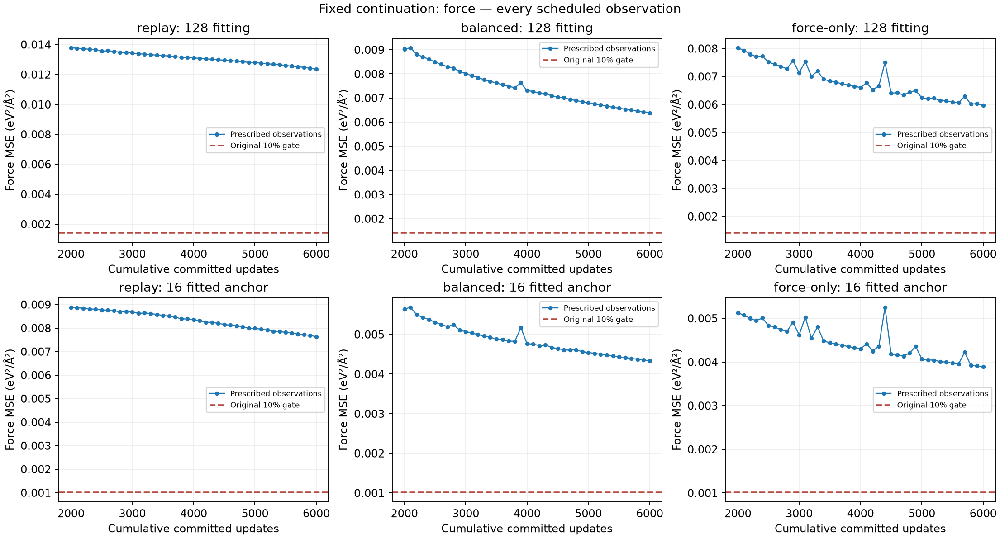

# Fixed continuation-budget diagnostics

Execution: **completed**. Interpretation valid: **True**. Full pilot: **pending**.

Additional committed updates: 12000; additional fitting-frame exposures: 1536000.
Raw energy MSE is averaged over frames; raw force MSE over atom-coordinate components. Baselines are the original fresh raw errors; energy is never recentered. The anchor is fully fitted, providing no held-out evidence.

Exactly three saved Adam controls, unchanged128fitting/16anchor, seed0/float64CPU/LR.001/16features and original loss weights. Source2000→6000,4000additional updates per arm,128exposures per update.42scheduled measurements, including2001 reconciled to the prior actual Adam probe; warmup proposals discarded. No best checkpoint or learning early stop. Per-arm1200s/controller3900s boundary caps include verification/output.

| Arm | Status | Global updates | Additional updates | New exposures | Cumulative exposures | Joint original gate |
|---|---|---:|---:|---:|---:|---|
| replay | completed | 6000 | 4000 | 512000 | 768000 | False |
| balanced | completed | 6000 | 4000 | 512000 | 768000 | False |
| force-only | completed | 6000 | 4000 | 512000 | 768000 | False |

| Arm | Role | Raw E MSE | Raw F MSE | Original E fraction | Original F fraction | E window reduction | F window reduction |
|---|---|---:|---:|---:|---:|---:|---:|
| replay | fitting | 0.001907930729 | 0.01234819755 | 0.05085541799 | 0.8767568128 | -0.0694251892 | 0.0201304561 |
| replay | anchor | 0.0005844613637 | 0.00763244028 | 0.009534698444 | 0.7531844155 | -0.8475476566 | 0.0237852449 |
| balanced | fitting | 0.01208163777 | 0.006382688336 | 0.3220330431 | 0.4531888528 | 0.02021938479 | 0.03037009109 |
| balanced | anchor | 0.006685050407 | 0.004331789429 | 0.1090575762 | 0.4274696126 | -0.1070966579 | 0.02284526204 |
| force-only | fitting | 10750.31915 | 0.00596559368 | 286547.0772 | 0.4235739572 | 0.009313842857 | 0.02071440712 |
| force-only | anchor | 10727.54783 | 0.003889836513 | 175005.4665 | 0.3838568181 | 0.00925560009 | 0.02092077697 |

Replay/balanced joint learning accepted: **False**. Force-only force gate: **False**, separate from joint acceptance/full pilot.

Terminal reduction is signed(MSE5500−MSE6000)/MSE5500. Absolute change<1% is labelled only “small terminal-window change”; absent/zero baseline is unavailable. These labels do not establish convergence, stationarity, capacity limits, optimizer causality or eventual success. Budget sensitivity in this one fitted setting remains distinct from generalization and physical landscape recovery.

Missing/failed execution, counter/history/oracle/source/receipt or baseline verification blocks interpretation. Partial synchronized counts remain actual counts; pending interrupted work is unknown. Failed snapshots and all prescribed points are retained. No numerical retry or later intervention is automatic.

- balanced: failure/stop fixed_budget; synchronized update 6000, persisted update 6000, pending update unknown False.
- force-only: failure/stop fixed_budget; synchronized update 6000, persisted update 6000, pending update unknown False.
- replay: failure/stop fixed_budget; synchronized update 6000, persisted update 6000, pending update unknown False.

Source summary SHA256 `dae6ad9a54b421023e381b7fbe46803dcea1e364ed6395841411ef8cfadc4d0d`; report generator SHA256 `8205152b1d17f3669b5f24d15af3eef9fc7da6a4510e76f92b9eec69063eaccc`.
Complete raw/per-group/equal-group/overlap metrics, original fractions, weighted losses, actual histories, state/probe/source verification and checksums: [convergence-budget-diagnostics.json](convergence-budget-diagnostics.json). Trial trail: [PAPER_EVIDENCE_LOG.md](PAPER_EVIDENCE_LOG.md).

Historical source hashes identify the original research artifacts. Raw run archives, original launch packages and historical audit records referenced here are retained separately; this report is a research export. See [the reproduction note](../docs/REPRODUCTION.md).
