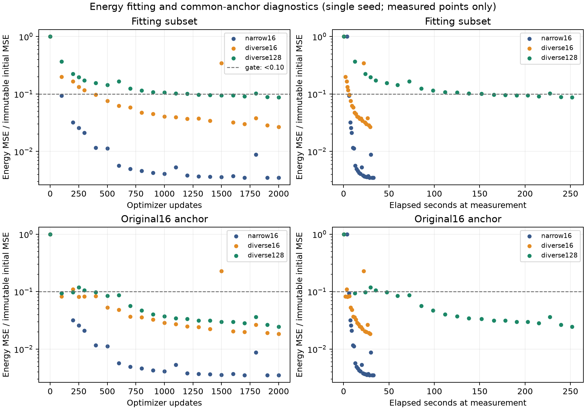
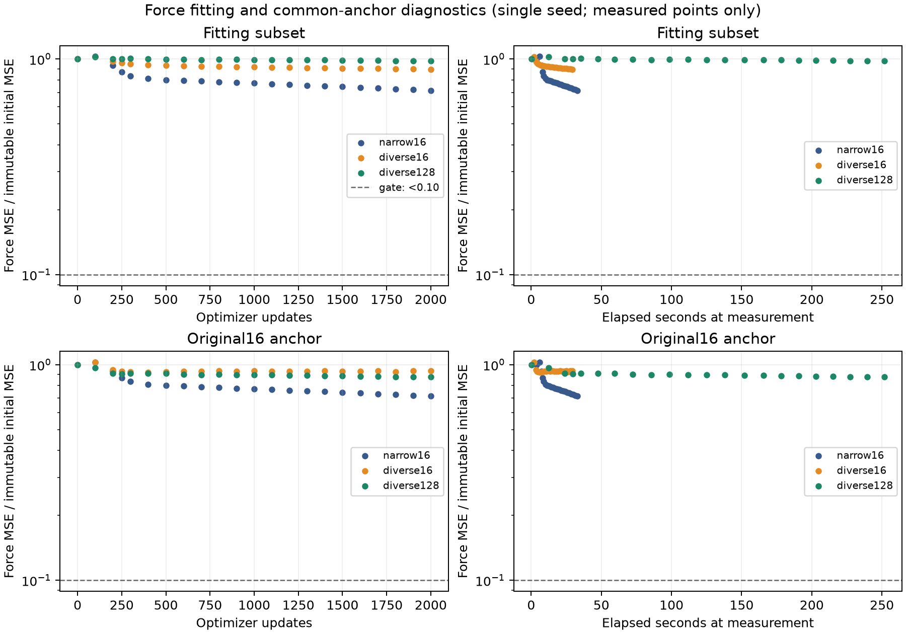
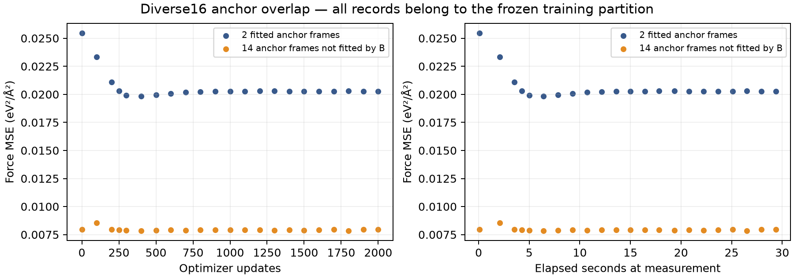

# Training-data coverage diagnostics

Matrix execution: **completed**. Full pilot remains **pending**.

These are training-only engineering controls, one seed per condition. They do not establish generalization or sample-count causality. Previous failed learning checks remain unchanged.

## Fixed protocol

Seed0, float64 CPU, zero energy head,16features/degree1/two message-passing iterations/eight radial basis functions/5Å cutoff, Adam1e-3 and unchanged train-only normalization. Each arm has2000updates/1800s including initialization, compilation, warmup, scoring and reload verification, with no learning early stop. C accumulates eight16-frame chunks at unchanged incoming parameters before one optimizer update.

A fits the original16 from connection01. B fits one frame per branch on eight connections (16total) and overlaps only2anchor records. C fits16frames per connection on the same eight groups (128total), containing both16sets. Support:01/23/77/58_2/44/22/78_2/01_2. Selection is label-blind and frozen.

## Outcomes

| Arm | Updates | Fit E fraction | Fit F fraction | Anchor E fraction | Anchor F fraction | Fit gate | Anchor gate | Wall seconds | Training frame exposures |
|---|---:|---:|---:|---:|---:|---|---|---:|---:|
| narrow16 | 2000 | 0.0035162569 | 0.71455228 | 0.0035162569 | 0.71455228 | fail | fail | 37.417 | 32000 |
| diverse16 | 2000 | 0.026691731 | 0.8967607 | 0.018387507 | 0.93875925 | fail | fail | 33.923 | 32000 |
| diverse128 | 2000 | 0.087380586 | 0.9784403 | 0.024702019 | 0.87699963 | fail | fail | 256.725 | 256000 |

Both energy and force MSE must independently remain below0.10of their immutable initial values to pass a gate. Fit gates use their own subset initial values. All anchor gates use fixed original16initial energy0.061298358531283896eV² and force0.010133561081129106eV²/Ų. Empty partitions/zero initial errors yield null ratios and cannot pass.

A replay: passed; maximum absolute MSE difference 6.5052130349130266e-18, using atol1e-10/rtol1e-8 at every historical100-update measurement through2000.

**narrow16:** completed; stop `max_updates`; all-frame fresh-process checkpoint verification: True. First observed fitting gate passage: none; anchor gate passage: none.

Final fitting E MSE=0.00021554077745390211, F MSE=0.0072409592005986808; original16E MSE=0.00021554077745390211, F MSE=0.0072409592005986808. Compilation=0.568s; warmup=0.028s; synchronized updates=28.066s; scoring=0.766s (704frame evaluations). Warmup exposures are separately recorded and excluded from training exposure counts.

**diverse16:** completed; stop `max_updates`; all-frame fresh-process checkpoint verification: True. First observed fitting gate passage: none; anchor gate passage: none.

Final fitting E MSE=0.00096684103328372915, F MSE=0.016087585922519309; original16E MSE=0.0011271239867643563, F MSE=0.0095129742205121923. Compilation=0.521s; warmup=0.028s; synchronized updates=28.322s; scoring=0.257s (704frame evaluations). Warmup exposures are separately recorded and excluded from training exposure counts.

**diverse128:** completed; stop `max_updates`; all-frame fresh-process checkpoint verification: True. First observed fitting gate passage: none; anchor gate passage: none.

Final fitting E MSE=0.0032782368371870292, F MSE=0.013780302581181741; original16E MSE=0.0015141932071812566, F MSE=0.00888712931225045. Compilation=0.585s; warmup=0.396s; synchronized updates=249.581s; scoring=1.069s (3168frame evaluations). Warmup exposures are separately recorded and excluded from training exposure counts.

B anchor overlap: 2fitted records, final F MSE=0.020278909839792178; 14records not fitted by B, final F MSE=0.0079749834177579096. Both partitions belong to global training; this is diagnostic transfer, not a held-out benchmark.

## Interpretation and next step

C did not pass both gates at the fixed budget. Extra coverage did not resolve the original fitting gate in this comparison. Preserve these results and return to a separately planned architecture/loss-gradient investigation. Partial improvements cannot justify selecting a successful run or relaxing the gate.

B changes fitted geometries and difficulty. C adds within-connection coverage and8times more frame exposures per update; equal updates are not equal compute. The elapsed-time plots show actual measurement times and do not estimate unmeasured metrics. The2versus14anchor partition is diagnostic overlap, not a scientific held-out split. No extra seed, GPU/full-pilot/scientific arm, loss/capacity/learning-rate change, longer budget or test evaluation occurred.

## Evidence and reproduction

- Raw run: `runs/aspirin-data-coverage-2026-09-30`; summary SHA256 `54e7f6d7e9995dbca90bdca3417457b075e99037dc9ecd6d6a1c0647ac102a9f`.
- Execution revision `356a3615e4693010ea9fc38d5874337991eb06dd`; source fingerprint `77dd790e53d96fa924de73feb03b812ce611772c5de50dcd63a7c2cd8475852f`.
- Frozen subsets `8139e442fca011efcbeb5f2d28d701c5f36030d61f045e5e652b98eb18b1be47`; dataset `4b9f220201d6483e2b2a8da74c10330c3762942ff4c6fabe6389ee27249c43aa`; split `73d5475bfc1f1158da62b939f5431b1781db886443cece2cdb297c8dd645133a`.
- Full-precision metrics, complete scheduled histories, initial state hashes and per-file checksums: [data-coverage-diagnostics.json](data-coverage-diagnostics.json).
- Trial preregistrations and all outcomes: [PAPER_EVIDENCE_LOG.md](PAPER_EVIDENCE_LOG.md), COVERAGE records.
- Rebuild this report/figures from saved runs: `.venv/bin/python scripts/report_data_coverage.py`.

Historical source hashes identify the original research artifacts. Raw run archives, original launch packages and historical audit records referenced here are retained separately; this report is a research export. See [the reproduction note](../docs/REPRODUCTION.md).
