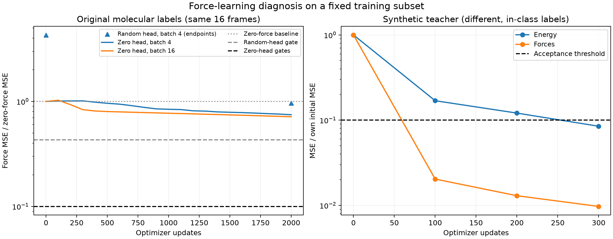

# Force-learning diagnosis, 30 September 2026

The implementation can learn a deliberately representable synthetic force field, but it still cannot fit the original molecular forces sufficiently on our fixed 16-frame subset. Both reviewed controls completed with finite outputs and independent-process checkpoint reproduction. The real-data learning criterion remains failed, so the full baseline pilot stays pending.

We preserved the original seed0, 16 training IDs, backbone, float64 precision, Adam1e-3 and train-derived loss scales. Each control had a 2000-update/1800-second cap and the original requirement that both energy and force MSE fall below 10% of their own initial values. The only sampling change was using all 16 frames per update. No validation or test array was opened. Two independent reviews cleared the exact plan before implementation and execution; their corrections and decisions are in `docs/reviews/2026-09-30-diagnostic-plan-review.md`.

## Actual outcomes

| Control | Updates | Initial energy MSE (eV²) | Final energy MSE (eV²) | Initial force MSE (eV²/A²) | Final force MSE (eV²/A²) | Force fraction remaining | Result |
|---|---:|---:|---:|---:|---:|---:|---|
| Synthetic teacher | 300 | 0.00008995229207048184 | 0.000007629829221195148 | 0.002091782319464598 | 0.000020318703322910553 | 0.009713584025373742 | Passed both thresholds |
| Original labels, full batch16 | 2000 | 0.061298358531283896 | 0.00021554077745390633 | 0.010133561081129106 | 0.007240959200598679 | 0.7145522825221747 | Force threshold failed; update cap |

Teacher energy fraction remaining was0.08482084275536658. We deliberately gave the teacher the student's initial backbone and changed only its readout, with seed23 kernel Normal(0,0.1) and a per-atom bias that centered molecular energy. This makes the target an easy in-class control. The 99.03% force-error reduction shows that this pipeline can learn that target under the prescribed settings; it does not establish DFT accuracy, general expressive capacity or generalization.

The original-label force improvement was28.5448% relative to the zero-force baseline, with force-component RMSE0.08509382586650267 eV/A. The prior zero-readout batch4 attempt ended at MSE0.0075721620581139844; the full-batch value0.007240959200598679 is modestly lower, but71.4552% of initial error remains against the required less-than10%. So this one controlled change did not resolve the failure. It cannot retroactively pass the original batch4 gate or establish that sampling noise is irrelevant under other settings.

Teacher and real-control wall times were10.746022709063254 and34.36673712497577 seconds respectively on the local CPU. These are engineering measurements, not GPU-hours or scientific speed comparisons. Fresh-process maximum prediction differences were2.1510571102112408e-16 and8.881784197001252e-16 against the fixed1e-10 tolerance. No continuation or additional seed ran.

## What the fixed-feature solves tell us

We differentiated the backbone's summed scalar features with respect to atomic positions, including the negative sign for forces. The molecular bias column equals atom count21; its force column is zero. Both actual and nonzero witness heads reconstructed the full model before solving. Original normalized energy/force MSEs used separate component counts, and every linear solve used the predeclared rcond1e-10.

| Frozen backbone | Readout objective | Rank | Energy MSE (eV²) | Force MSE (eV²/A²) |
|---|---|---:|---:|---:|
| Fresh seed0 | Force only, energy mean fitted afterward | 16 | 0.009370411512161263 | 0.008237971281002272 |
| Fresh seed0 | Original normalized joint loss | 17 | 0.0007420096271186995 | 0.00879886195790133 |
| Prior batch4 final | Force only, energy mean fitted afterward | 16 | 0.0024365124422744406 | 0.007373451310725372 |
| Prior batch4 final | Original normalized joint loss | 17 | 0.00033510516512580505 | 0.007501567117503857 |

Here the rank equals the available coefficient count in each solve. Even the force-only fits leave errors far above the zero-head gate0.0010133561081129106 eV²/A². Adjusting the linear head alone on these two fixed bodies therefore does not close that gap under this numerical solve. The joint fits trade some force accuracy for energy accuracy, as expected from the recorded objective. None of these values bounds what a differently trained backbone can represent.

The matrix condition numbers ranged from71.62 to9922.53, with coefficient L2 norms0.578 to5.043. Solved-head reconstruction errors remained below5.50e-15. Full singular values, coefficients, histories and identities are saved in `reports/force-learning-diagnostics.json`. The results narrow the investigation toward representation and nonlinear fitting, but they do not establish whether capacity, interactions, optimization budget or another mechanism is responsible. The next implementation plan should inspect those mechanisms and predeclare the next bounded probe before execution.

Figure1. Left: the three original-label runs use the same zero-force denominator. The first random-head run retained only initial/final full-subset metrics, so its two points are shown without an interpolated trajectory. Random-head and zero-head acceptance thresholds differ because their initial errors differ; both are shown. Right: the synthetic teacher uses different labels and each metric's own initial error, so its curve is a pipeline control rather than a molecular accuracy comparison.

## Reproducibility and claim boundary

Production run: `runs/aspirin-force-diagnostics-2026-09-30`; exact configuration: `configs/aspirin-force-diagnostics.json`; execution revision88d170480b540b18f5379d324c34271d2a9c4068; code fingerprint4d8bd570ce6ceffc49bc99f95e7fb4e939c789d14864d11f4ad8c7aba58f9e3c. The prepared identity and original16-ID hash remain unchanged. Historical checkpoint provenance is retained separately from current execution provenance. The tracked compact JSON contains every run artifact's SHA256, original configuration, current/historical identities and numeric evidence; large run arrays/checkpoints remain local ignored artifacts.

All prior failures remain in the evidence log, followed by prospective and actual entries for these controls. Execution validity is separate from learning success: the diagnostic controller's `completed` status means the controls ran and were verified, while the real run's `incomplete` status means its force acceptance failed. Paracetamol preparation, GPU verification, full pilot, scientific comparison arms and held-out test evaluation remain pending or blocked. No paper hypothesis has been validated by these engineering diagnostics.

Historical source hashes identify the original research artifacts. Raw run archives, original launch packages and historical audit records referenced here are retained separately; this report is a research export. See [the reproduction note](../docs/REPRODUCTION.md).
