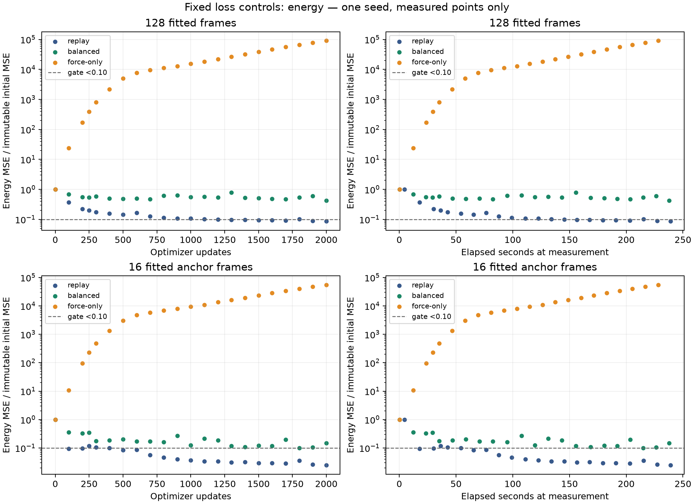
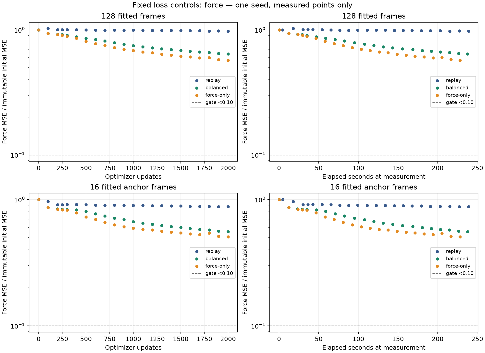

# Controlled fixed loss-balance diagnostics

Matrix: **completed**; operationally valid: **True**. Full pilot: **pending**.

Balanced joint acceptance: **False**. Force-only force acceptance: **False**.
Attempted arms: 3; completed: 3; blocked: 0.

## Fixed protocol

One seed (0), float64 CPU, 128 fitting frames and original16 anchor; all 16 anchor records are fitted. Frozen zero-head model: 16 features, degree1, two message-passing iterations, eight radial bases, 5Å cutoff. Adam learning rate0.001, 2000updates /256000training frame exposures per arm, microbatch16, wall cap1800s including initialization, compilation, warmup, scoring and fresh-process checkpoint verification. Warmup128frame exposures are discarded and recorded separately. No early stop, retries, resume, weight search or adaptation.

Replay weights: energy1/force1. Balanced weights: energy0.014584365670390719/force1.9854156343296092; force-only: energy0/force2. Raw MSEs are divided by unchanged train-only squared loss scales before fixed weighting. Calibration uses fresh-C whole-tree gradient norms, energy72.41148277153111/force0.531916604873417, energy/force ratio136.13314964807924. The whole-tree energy norm includes energy-only bias59.332970471878184; this balances initial whole-tree norm contributions only, not shared-parameter contributions or later gradients/Adam updates.

Original raw gates remain strict: both energy and force MSE <0.1 immutable initial error on fitting AND anchor for balanced acceptance. Force-only acceptance reports only force on both partitions and cannot clear the joint gate. Force-only leaves the absolute energy gauge unconstrained; the fixed normalization offset is retained, without recentering.

## Fixed endpoints

| Arm | Status | Updates | Fit E fraction | Fit F fraction | Anchor E fraction | Anchor F fraction | Fit joint | Anchor joint | Wall seconds | Training exposures |
|---|---|---:|---:|---:|---:|---:|---|---|---:|---:|
| replay | completed | 2000 | 0.0873805857 | 0.978440304 | 0.0247020188 | 0.876999629 | False | False | 243.637975 | 256000 |
| balanced | completed | 2000 | 0.422010707 | 0.64118559 | 0.149810296 | 0.556292794 | False | False | 242.549911 | 256000 |
| force-only | completed | 2000 | 90243.0888 | 0.569943866 | 55075.1711 | 0.505936923 | False | False | 232.942042 | 256000 |

Replay comparison: `{"compared_updates": [0, 100, 200, 250, 300, 400, 500, 600, 700, 800, 900, 1000, 1100, 1200, 1300, 1400, 1500, 1600, 1700, 1800, 1900, 2000], "maximum_absolute_mse_difference": 0.0, "status": "passed", "tolerance": {"atol": 1e-10, "rtol": 1e-08}}`.

### replay

Stop: `max_updates`; failure: `none`; checkpoint fresh-process verification: True.
Compilation 0.880313917s; warmup 0.33921475s; synchronized updates 232.000477s; scoring 1.84119171s; evaluation frames 3168; warmup exposures 128.

initial_metrics:

| Partition/group | Records | Energy MSE (eV²) | Force MSE (eV²/Ų) |
|---|---:|---:|---:|
| anchor | 16 | 0.0612983585 | 0.0101335611 |
| anchor/01 | 16 | 0.0612983585 | 0.0101335611 |
| anchor/equal_group | — | 0.0612983585 | 0.0101335611 |
| anchor_fitted | 16 | 0.0612983585 | 0.0101335611 |
| anchor_fitted/01 | 16 | 0.0612983585 | 0.0101335611 |
| anchor_fitted/equal_group | — | 0.0612983585 | 0.0101335611 |
| anchor_not_fitted | 0 | — | — |
| anchor_not_fitted/equal_group | — | — | — |
| fitting | 128 | 0.0375167643 | 0.0140839482 |
| fitting/01 | 16 | 0.0612983585 | 0.0101335611 |
| fitting/01_2 | 16 | 0.0613096256 | 0.0126437811 |
| fitting/22 | 16 | 0.0256547882 | 0.0031611764 |
| fitting/23 | 16 | 0.0197208194 | 0.0139898865 |
| fitting/44 | 16 | 0.00433008858 | 0.00272153585 |
| fitting/58_2 | 16 | 0.0693028576 | 0.0475551289 |
| fitting/77 | 16 | 0.0498889048 | 0.0104619354 |
| fitting/78_2 | 16 | 0.00862867136 | 0.0120045805 |
| fitting/equal_group | — | 0.0375167643 | 0.0140839482 |

final_metrics:

| Partition/group | Records | Energy MSE (eV²) | Force MSE (eV²/Ų) |
|---|---:|---:|---:|
| anchor | 16 | 0.00151419321 | 0.00888712931 |
| anchor/01 | 16 | 0.00151419321 | 0.00888712931 |
| anchor/equal_group | — | 0.00151419321 | 0.00888712931 |
| anchor_fitted | 16 | 0.00151419321 | 0.00888712931 |
| anchor_fitted/01 | 16 | 0.00151419321 | 0.00888712931 |
| anchor_fitted/equal_group | — | 0.00151419321 | 0.00888712931 |
| anchor_not_fitted | 0 | — | — |
| anchor_not_fitted/equal_group | — | — | — |
| fitting | 128 | 0.00327823684 | 0.0137803026 |
| fitting/01 | 16 | 0.00151419321 | 0.00888712931 |
| fitting/01_2 | 16 | 0.00245016454 | 0.0116180028 |
| fitting/22 | 16 | 0.00230823406 | 0.00462727844 |
| fitting/23 | 16 | 0.00201781487 | 0.0130869797 |
| fitting/44 | 16 | 0.0015108568 | 0.00440494617 |
| fitting/58_2 | 16 | 0.0113831745 | 0.0445453357 |
| fitting/77 | 16 | 0.00337189961 | 0.0117236199 |
| fitting/78_2 | 16 | 0.00166955706 | 0.0113491286 |
| fitting/equal_group | — | 0.00327823684 | 0.0137803026 |

### balanced

Stop: `max_updates`; failure: `none`; checkpoint fresh-process verification: True.
Compilation 0.613944166s; warmup 0.226899375s; synchronized updates 235.498686s; scoring 1.037011s; evaluation frames 3168; warmup exposures 128.

initial_metrics:

| Partition/group | Records | Energy MSE (eV²) | Force MSE (eV²/Ų) |
|---|---:|---:|---:|
| anchor | 16 | 0.0612983585 | 0.0101335611 |
| anchor/01 | 16 | 0.0612983585 | 0.0101335611 |
| anchor/equal_group | — | 0.0612983585 | 0.0101335611 |
| anchor_fitted | 16 | 0.0612983585 | 0.0101335611 |
| anchor_fitted/01 | 16 | 0.0612983585 | 0.0101335611 |
| anchor_fitted/equal_group | — | 0.0612983585 | 0.0101335611 |
| anchor_not_fitted | 0 | — | — |
| anchor_not_fitted/equal_group | — | — | — |
| fitting | 128 | 0.0375167643 | 0.0140839482 |
| fitting/01 | 16 | 0.0612983585 | 0.0101335611 |
| fitting/01_2 | 16 | 0.0613096256 | 0.0126437811 |
| fitting/22 | 16 | 0.0256547882 | 0.0031611764 |
| fitting/23 | 16 | 0.0197208194 | 0.0139898865 |
| fitting/44 | 16 | 0.00433008858 | 0.00272153585 |
| fitting/58_2 | 16 | 0.0693028576 | 0.0475551289 |
| fitting/77 | 16 | 0.0498889048 | 0.0104619354 |
| fitting/78_2 | 16 | 0.00862867136 | 0.0120045805 |
| fitting/equal_group | — | 0.0375167643 | 0.0140839482 |

final_metrics:

| Partition/group | Records | Energy MSE (eV²) | Force MSE (eV²/Ų) |
|---|---:|---:|---:|
| anchor | 16 | 0.00918312522 | 0.00563722701 |
| anchor/01 | 16 | 0.00918312522 | 0.00563722701 |
| anchor/equal_group | — | 0.00918312522 | 0.00563722701 |
| anchor_fitted | 16 | 0.00918312522 | 0.00563722701 |
| anchor_fitted/01 | 16 | 0.00918312522 | 0.00563722701 |
| anchor_fitted/equal_group | — | 0.00918312522 | 0.00563722701 |
| anchor_not_fitted | 0 | — | — |
| anchor_not_fitted/equal_group | — | — | — |
| fitting | 128 | 0.0158324762 | 0.00903042465 |
| fitting/01 | 16 | 0.00918312522 | 0.00563722701 |
| fitting/01_2 | 16 | 0.00989644557 | 0.00803202477 |
| fitting/22 | 16 | 0.00451780505 | 0.00326170933 |
| fitting/23 | 16 | 0.00831356557 | 0.0113950927 |
| fitting/44 | 16 | 0.00898803156 | 0.00328216101 |
| fitting/58_2 | 16 | 0.0363249274 | 0.0238088985 |
| fitting/77 | 16 | 0.0439363607 | 0.00887201972 |
| fitting/78_2 | 16 | 0.00549954871 | 0.00795426415 |
| fitting/equal_group | — | 0.0158324762 | 0.00903042465 |

### force-only

Stop: `max_updates`; failure: `none`; checkpoint fresh-process verification: True.
Compilation 0.560655541s; warmup 0.1276405s; synchronized updates 226.297023s; scoring 0.978922541s; evaluation frames 3168; warmup exposures 128.

initial_metrics:

| Partition/group | Records | Energy MSE (eV²) | Force MSE (eV²/Ų) |
|---|---:|---:|---:|
| anchor | 16 | 0.0612983585 | 0.0101335611 |
| anchor/01 | 16 | 0.0612983585 | 0.0101335611 |
| anchor/equal_group | — | 0.0612983585 | 0.0101335611 |
| anchor_fitted | 16 | 0.0612983585 | 0.0101335611 |
| anchor_fitted/01 | 16 | 0.0612983585 | 0.0101335611 |
| anchor_fitted/equal_group | — | 0.0612983585 | 0.0101335611 |
| anchor_not_fitted | 0 | — | — |
| anchor_not_fitted/equal_group | — | — | — |
| fitting | 128 | 0.0375167643 | 0.0140839482 |
| fitting/01 | 16 | 0.0612983585 | 0.0101335611 |
| fitting/01_2 | 16 | 0.0613096256 | 0.0126437811 |
| fitting/22 | 16 | 0.0256547882 | 0.0031611764 |
| fitting/23 | 16 | 0.0197208194 | 0.0139898865 |
| fitting/44 | 16 | 0.00433008858 | 0.00272153585 |
| fitting/58_2 | 16 | 0.0693028576 | 0.0475551289 |
| fitting/77 | 16 | 0.0498889048 | 0.0104619354 |
| fitting/78_2 | 16 | 0.00862867136 | 0.0120045805 |
| fitting/equal_group | — | 0.0375167643 | 0.0140839482 |

final_metrics:

| Partition/group | Records | Energy MSE (eV²) | Force MSE (eV²/Ų) |
|---|---:|---:|---:|
| anchor | 16 | 3376.01759 | 0.00512694271 |
| anchor/01 | 16 | 3376.01759 | 0.00512694271 |
| anchor/equal_group | — | 3376.01759 | 0.00512694271 |
| anchor_fitted | 16 | 3376.01759 | 0.00512694271 |
| anchor_fitted/01 | 16 | 3376.01759 | 0.00512694271 |
| anchor_fitted/equal_group | — | 3376.01759 | 0.00512694271 |
| anchor_not_fitted | 0 | — | — |
| anchor_not_fitted/equal_group | — | — | — |
| fitting | 128 | 3385.62869 | 0.0080270599 |
| fitting/01 | 16 | 3376.01759 | 0.00512694271 |
| fitting/01_2 | 16 | 3377.38956 | 0.00774809172 |
| fitting/22 | 16 | 3378.14709 | 0.00325009143 |
| fitting/23 | 16 | 3372.06091 | 0.0109897226 |
| fitting/44 | 16 | 3388.49665 | 0.00318020964 |
| fitting/58_2 | 16 | 3407.92125 | 0.0182676213 |
| fitting/77 | 16 | 3394.87504 | 0.00859317158 |
| fitting/78_2 | 16 | 3390.12144 | 0.00706062826 |
| fitting/equal_group | — | 3385.62869 | 0.0080270599 |

## Interpretation and limitations

The balanced arm did not clear both joint gates at the fixed endpoint. Retain all three prescribed outcomes and review the measured tradeoffs before any new intervention. Force-only improvement is a separate ablation result.

Elapsed times include local runtime effects; focused verification overlapped replay preflight/initialization, so these are recorded timings rather than clean throughput comparisons. No causal attribution to Adam, no capacity theorem, no generalization claim: one frozen coefficient pair, one seed and a fully fitted anchor. Equality of initial whole-tree gradient norms does not imply equality of optimizer steps or sustained balance. These results do not decide other weights, architectures, optimizers or larger budgets. All scheduled observations and failed/blocked trials are retained.

Next step: `review_fixed_loss_outcomes_before_new_intervention`.

## Evidence

Run `runs/aspirin-loss-balance-2026-09-30`; summary SHA256 `7d74cb95ae16f7503da5098fcfb0a6b7bbf9f74a6edc975238dac47a154bdd49`; generator SHA256 `405dc96c6f1f77d0112c543df8ecdc8a4255eb033e4c51798343d0c84d5ef5aa`.
Complete raw metrics, histories, calibration/source identities, initial hashes, per-group errors and artifact checksums: [loss-balance-diagnostics.json](loss-balance-diagnostics.json). Trial rationale/settings/outcomes/stops: [PAPER_EVIDENCE_LOG.md](PAPER_EVIDENCE_LOG.md), BALANCE entries. Rebuild from JSON only: `.venv/bin/python scripts/report_loss_balance.py`.

Historical source hashes identify the original research artifacts. Raw run archives, original launch packages and historical audit records referenced here are retained separately; this report is a research export. See [the reproduction note](../docs/REPRODUCTION.md).
