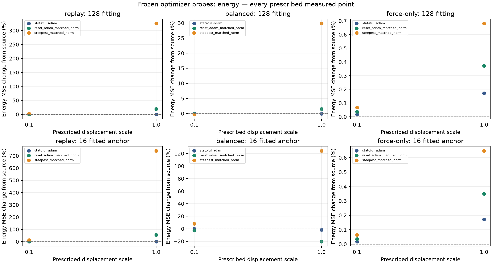
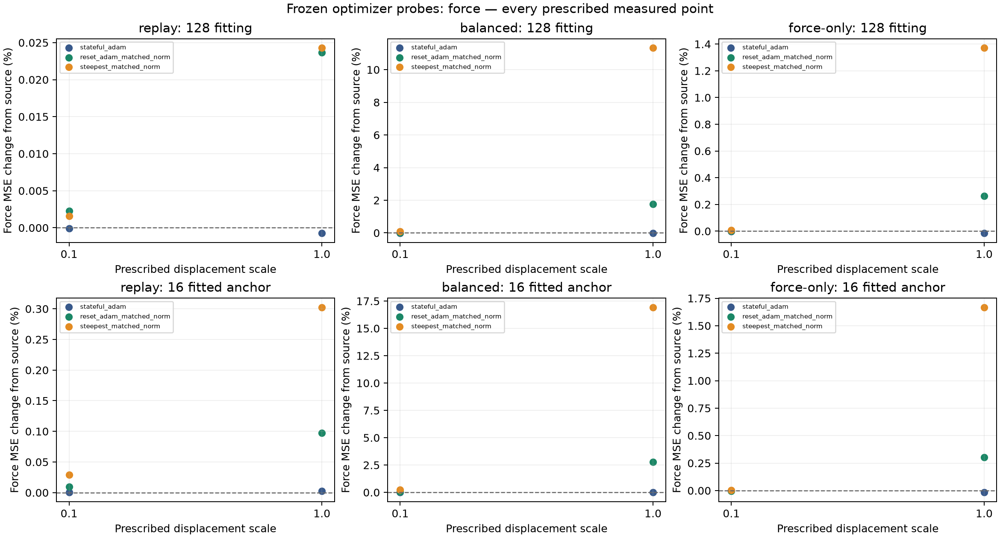

# Frozen optimizer-step diagnostics

Execution: **completed**. Interpretation valid: **True**. Full pilot: **pending**.

Attempted cases: 3; completed: 3; blocked: 0.
Recorded FD cells: 36; FD step records: 72; counterfactual probes: 18.
Committed training frame exposures: 0. Started but unconfirmed operations: 0 (partial work is unknown).

## Fixed protocol

Three saved 2000-update Adam checkpoints, seed0, float64CPU, unchanged128fitting frames and16 fully fitted anchor frames. Same16features/degree1/twoiterations/eightbases/5Å zero-head model, train-only normalization and source weights. Frozen total diagnostic boundary cap600s includes source checks, compilation and output; operations cannot be forcibly cancelled.
The actual saved-moment Adam proposal at learning rate0.001 is verified independently, using incomingcount+1 (ephemeral2001), b1=.9,b2=.999,eps=1e-8,eps_root=0,nesterovFalse. Advanced states are discarded. Fresh-moment Adam and negative weighted-gradient references are rescaled to the actual whole-tree proposal norm. Directions are formed using fitting data, then evaluated unchanged on both roles. Equal whole-tree norms do not equalize perparameter displacement or compute.
Central differences along each available unit direction use bothh1e-4/1e-5 for both normalized objectives on both roles, atol1e-8/rtol1e-4; at least one must pass percell. Both steps are preserved, including failures. Passing tolerance does not certify the sign of a slope close to numerical tolerance. Exactlyscale0.1/1 temporarydisplacements; no winner selection, offset recentering, learning-rate change or persistent update.

Original raw learning gates remain strict <0.1 of immutable initial MSE. A temporary counterfactual gate cannot clear learning acceptance. All anchor records are fitted; this provides no held-out/generalization evidence.

## Local directions and finite changes

| Case | Direction | Role | Direction norm | Energy slope | Force slope | Weighted slope | Energy cosine | Force cosine |
|---|---|---|---:|---:|---:|---:|---:|---:|
| replay | reset_adam_matched_norm | anchor | 0.003473292204 | 0.004085498418 | 0.0005268731473 | 0.004612371565 | 0.2287218357 | 0.1437024219 |
| replay | reset_adam_matched_norm | fitting | 0.003473292204 | -0.001006242775 | 0.0001912133639 | -0.0008150294113 | -0.2177034783 | 0.06109810318 |
| replay | stateful_adam | anchor | 0.003473292204 | 0.0002465589532 | 1.381699126e-05 | 0.0002603759445 | 0.01380331372 | 0.003768525911 |
| replay | stateful_adam | fitting | 0.003473292204 | -8.019122022e-05 | -6.164687509e-06 | -8.635590773e-05 | -0.01734959793 | -0.001969792832 |
| replay | steepest_matched_norm | anchor | 0.003473292204 | 0.01736963209 | 0.001603407541 | 0.01897303963 | 0.9724184738 | 0.4373226233 |
| replay | steepest_matched_norm | fitting | 0.003473292204 | -0.003403674826 | 0.00012591978 | -0.003277755046 | -0.7363947022 | 0.0402349478 |
| balanced | reset_adam_matched_norm | anchor | 0.004365511232 | -0.05139544095 | 0.0006326902465 | 0.0005065832026 | -0.03367928099 | 0.05320470781 |
| balanced | reset_adam_matched_norm | fitting | 0.004365511232 | -0.005884569844 | -0.0003187666897 | -0.0007187070878 | -0.08112622297 | -0.3785062899 |
| balanced | stateful_adam | anchor | 0.004365511232 | -0.003158290237 | -3.759879349e-05 | -0.0001207108921 | -0.002069618285 | -0.00316178862 |
| balanced | stateful_adam | fitting | 0.004365511232 | -0.0002802012492 | -7.855605728e-05 | -0.0001600529818 | -0.003862927899 | -0.09327813336 |
| balanced | steepest_matched_norm | anchor | 0.004365511232 | 0.1461846121 | 0.002029683079 | 0.006161774355 | 0.0957943455 | 0.1706817763 |
| balanced | steepest_matched_norm | fitting | 0.004365511232 | -0.02040752609 | -0.000669189144 | -0.001626249412 | -0.2813435062 | -0.7946009051 |
| force-only | reset_adam_matched_norm | anchor | 0.003172515736 | 252.9557899 | -0.0001936108256 | -0.0003872216512 | 0.1220447992 | -0.01933069951 |
| force-only | reset_adam_matched_norm | fitting | 0.003172515736 | 269.7747021 | -0.0001283669964 | -0.0002567339928 | 0.124239988 | -0.5226558934 |
| force-only | stateful_adam | anchor | 0.003172515736 | 124.1850796 | -5.837616246e-05 | -0.0001167523249 | 0.05991617392 | -0.005828455363 |
| force-only | stateful_adam | fitting | 0.003172515736 | 125.0859893 | -7.693648972e-05 | -0.0001538729794 | 0.05760614945 | -0.3132527122 |
| force-only | steepest_matched_norm | anchor | 0.003172515736 | 467.8896236 | -0.0004903243558 | -0.0009806487117 | 0.2257449618 | -0.04895548972 |
| force-only | steepest_matched_norm | fitting | 0.003172515736 | 493.1446012 | -0.0002456051831 | -0.0004912103662 | 0.2271090613 | -1 |

| Case | Direction | Scale | Role | Raw E MSE | Raw F MSE | E original fraction | F original fraction | E source change % | F source change % |
|---|---|---:|---|---:|---:|---:|---:|---:|---:|
| replay | stateful_adam | 0.1 | fitting | 0.003277892038 | 0.01378029266 | 0.0873713952 | 0.9784395999 | -0.01051782481 | -7.199962503e-05 |
| replay | stateful_adam | 0.1 | anchor | 0.001515369515 | 0.00888715156 | 0.02472120872 | 0.8770018248 | 0.07768548134 | 0.0002503362114 |
| replay | stateful_adam | 1.0 | fitting | 0.00327738086 | 0.01378020368 | 0.08735776986 | 0.9784332818 | -0.02611091343 | -0.0007177332075 |
| replay | stateful_adam | 1.0 | anchor | 0.001528447568 | 0.008887351983 | 0.02493455949 | 0.877021603 | 0.9413831954 | 0.002505543992 |
| replay | reset_adam_matched_norm | 0.1 | fitting | 0.003280277329 | 0.01378061224 | 0.08743497452 | 0.9784622913 | 0.06224356479 | 0.002247138056 |
| replay | reset_adam_matched_norm | 0.1 | anchor | 0.001539644866 | 0.008887978999 | 0.0251172283 | 0.8770834781 | 1.680872592 | 0.009560867896 |
| replay | reset_adam_matched_norm | 1.0 | fitting | 0.003904112921 | 0.01378356172 | 0.1040631567 | 0.9786717121 | 19.09185074 | 0.02365067698 |
| replay | reset_adam_matched_norm | 1.0 | anchor | 0.002346327273 | 0.008895753357 | 0.03827716319 | 0.8778506673 | 54.95560684 | 0.09703971271 |
| replay | steepest_matched_norm | 0.1 | fitting | 0.003370616327 | 0.01378051851 | 0.08984293801 | 0.9784556358 | 2.817962663 | 0.001566926374 |
| replay | steepest_matched_norm | 0.1 | anchor | 0.001699321809 | 0.008889721478 | 0.02772214215 | 0.8772554294 | 12.2262206 | 0.02916763684 |
| replay | steepest_matched_norm | 1.0 | fitting | 0.01392522269 | 0.01378364765 | 0.3711733396 | 0.9786778139 | 324.7778113 | 0.02427429706 |
| replay | steepest_matched_norm | 1.0 | anchor | 0.01272713137 | 0.008914008752 | 0.2076259736 | 0.879652146 | 740.5222869 | 0.3024535692 |
| balanced | stateful_adam | 0.1 | fitting | 0.0158311899 | 0.009030300005 | 0.4219764206 | 0.64117674 | -0.008124619505 | -0.001380248782 |
| balanced | stateful_adam | 0.1 | anchor | 0.009168429936 | 0.005637168132 | 0.149570562 | 0.5562869841 | -0.1600248392 | -0.001044471869 |
| balanced | stateful_adam | 1.0 | fitting | 0.01582132658 | 0.009029343408 | 0.4217135162 | 0.6411088189 | -0.07042265307 | -0.01197329496 |
| balanced | stateful_adam | 1.0 | anchor | 0.009037810455 | 0.005636787312 | 0.1474396814 | 0.5562494041 | -1.582410769 | -0.007799917983 |
| balanced | reset_adam_matched_norm | 0.1 | fitting | 0.01581034866 | 0.009031549036 | 0.4214209025 | 0.6412654247 | -0.1397606366 | 0.0124511183 |
| balanced | reset_adam_matched_norm | 0.1 | anchor | 0.008948920102 | 0.005639706571 | 0.1459895553 | 0.5565374823 | -2.550385731 | 0.04398544272 |
| balanced | reset_adam_matched_norm | 1.0 | fitting | 0.01607377309 | 0.009189093677 | 0.428442415 | 0.652451538 | 1.524062668 | 1.757049483 |
| balanced | reset_adam_matched_norm | 1.0 | anchor | 0.00729970766 | 0.005793554832 | 0.1190848798 | 0.5717195352 | -20.5095489 | 2.773133314 |
| balanced | steepest_matched_norm | 0.1 | fitting | 0.01578790283 | 0.009039633978 | 0.4208226146 | 0.6418394784 | -0.2815314335 | 0.1019811547 |
| balanced | steepest_matched_norm | 0.1 | anchor | 0.009905345865 | 0.00564966069 | 0.161592351 | 0.5575197746 | 7.864649902 | 0.2205637399 |
| balanced | steepest_matched_norm | 1.0 | fitting | 0.02055079873 | 0.01005343264 | 0.5477764174 | 0.7138220393 | 29.80154482 | 11.32845942 |
| balanced | steepest_matched_norm | 1.0 | anchor | 0.02060036634 | 0.006591314398 | 0.3360671775 | 0.6504440389 | 124.3284922 | 16.92476434 |
| force-only | stateful_adam | 0.1 | fitting | 3386.211476 | 0.008026936829 | 90258.62282 | 0.5699351279 | 0.01721356092 | -0.001533235539 |
| force-only | stateful_adam | 0.1 | anchor | 3376.596176 | 0.005126849402 | 55084.61004 | 0.5059277149 | 0.01713823115 | -0.001820000303 |
| force-only | stateful_adam | 1.0 | fitting | 3391.461148 | 0.008025900798 | 90398.55153 | 0.5698615668 | 0.1722710906 | -0.01443996845 |
| force-only | stateful_adam | 1.0 | anchor | 3381.808024 | 0.005126070519 | 55169.63432 | 0.5058508532 | 0.1715168333 | -0.01701194969 |
| force-only | reset_adam_matched_norm | 0.1 | fitting | 3386.885707 | 0.008027084842 | 90276.59427 | 0.5699456372 | 0.03712805099 | 0.000310686622 |
| force-only | reset_adam_matched_norm | 0.1 | anchor | 3377.196231 | 0.005126816603 | 55094.39913 | 0.5059244783 | 0.0349122897 | -0.0024597367 |
| force-only | reset_adam_matched_norm | 1.0 | fitting | 3398.218904 | 0.008048181751 | 90578.67781 | 0.5714435772 | 0.3718722877 | 0.2631330569 |
| force-only | reset_adam_matched_norm | 1.0 | anchor | 3387.822371 | 0.005142409631 | 55267.75026 | 0.5074632293 | 0.3496659766 | 0.3016791706 |
| force-only | steepest_matched_norm | 0.1 | fitting | 3387.926772 | 0.008027800273 | 90304.34359 | 0.5699964348 | 0.06787757526 | 0.00922342627 |
| force-only | steepest_matched_norm | 0.1 | anchor | 3378.197952 | 0.005127083821 | 55110.74086 | 0.5059508479 | 0.0645839815 | 0.002752304194 |
| force-only | steepest_matched_norm | 1.0 | fitting | 3408.670554 | 0.008137086647 | 90857.26395 | 0.5777560753 | 0.6805786344 | 1.370697934 |
| force-only | steepest_matched_norm | 1.0 | anchor | 3397.87678 | 0.005212433888 | 55431.77438 | 0.5143733626 | 0.6474846045 | 1.667488416 |

## Verification, failures and limits

- replay: completed; attempted True; retained counts {'fd_cells': 12, 'fd_steps': 24, 'probes': 6}; failure/stop: none.
- balanced: completed; attempted True; retained counts {'fd_cells': 12, 'fd_steps': 24, 'probes': 6}; failure/stop: none.
- force-only: completed; attempted True; retained counts {'fd_cells': 12, 'fd_steps': 24, 'probes': 6}; failure/stop: none.

These verified local slopes and fixed finite displacements describe the three saved states. Negative fitting force slope plus lower finite force indicates a feasible local improvement at that point. Positive slope or increase describes the exact saved direction/nonlinearity; one local step cannot establish accumulated optimizer causality. These observations do not establish convergence, capacity limits or eventual gate passage. No future training intervention has been executed.

Completed model/gradient frame passes by category: `{"fd": 5184, "gradient_energy": 432, "gradient_force": 432, "loss_source_predictions": 432, "parent_source_predictions": 208, "probe": 2592, "reference_builder": 384, "source_predictions": 432, "weighted_gradient": 384}`. Opaque parent source verification and reference-builder work count only after synchronized completion; interrupted operations retain unknown partial work. These counts are diagnostic passes, not hardware FLOPs or training exposures.

Source summary SHA256 `3255465553f165b8979475a23681c9a490bef098f05bdb1387e316561cbd4b9b`; report generator SHA256 `53d9447e39e39e7b02838fc31a3d8c6a672cd1b2b13a0c2366bcbc2377b2ff8d`.
Complete raw/per-group/equal-group/overlap metrics, original fractions, weighted losses, both FD steps, block geometry, failed/partial work and all file checksums: [optimizer-step-diagnostics.json](optimizer-step-diagnostics.json). Trial trail: [PAPER_EVIDENCE_LOG.md](PAPER_EVIDENCE_LOG.md), OPTSTEP entries.

