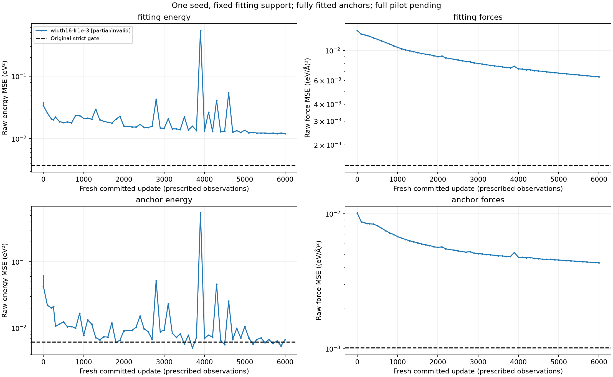

# Fresh width and fixed-rate diagnostic

Saved execution status: **failed**; interpretation valid: **False**. Full pilot: **pending**.

| Cell | Saved updates | Persisted updates | Raw fitted E MSE | Raw fitted F MSE | Joint fitting gate | Joint anchor gate | Verified |
|---|---:|---:|---:|---:|---|---|---|
| width16-lr1e-3 | 6000 | 6000 | 0.012081637766089288 | 0.006382688336423198 | False | False | False |
| width16-lr3e-4 | unavailable | unavailable | unavailable | unavailable | unavailable | unavailable | False |
| width32-lr1e-3 | unavailable | unavailable | unavailable | unavailable | unavailable | unavailable | False |
| width32-lr3e-4 | unavailable | unavailable | unavailable | unavailable | unavailable | unavailable | False |

Actual counters: `{"attempted_updates": 6000, "committed_frame_exposures": 768000, "committed_updates": 6000, "discarded_warmup_frames": 128, "known_parent_reference_prediction_frames": 144, "parent_work": {"completed_source_prediction_frames": 208, "elapsed_seconds": 3.86947870899985, "historical_template_initializations": 1, "operation": "historical_parent_preflight", "status": "completed"}, "shared_training_initializations_completed": 2, "synchronized_frame_exposures": 768000, "synchronized_updates": 6000, "unknown_pending_cells": [], "unknown_pending_preflight_operations": [], "unknown_probe_cells": ["width16-lr1e-3"], "work_counts_complete": false}`.

Measured matrix elapsed: 694.8040945419998 seconds. Shared training initialization is actual work once per width; paired cap charges are separate. Historical parent template initialization/source verification and discarded reference/warmup work are retained separately.

Four-cell endpoint contrasts available: **False**. Ratios and descriptive 5500→6000 window changes are in the JSON; no selected endpoint.

Every raw/per-group/equal-group/overlap history, original fraction, weighted loss, checkpoint pair, receipt, parameter count and timing is preserved in the JSON and raw artifacts. Learning failure is distinct from execution failure; all attempts remain in the denominators.

- One seed; fully fitted anchors; no generalization, convergence, capacity or optimizer-causal conclusion.
- A worse lower fresh fixed-rate endpoint does not test smaller late-stage rates or decay schedules.
- Sequential wall times depend on order, compiler cache and system load; no architecture-efficiency ranking.
- Width changes initialization shape, parameter count and optimization geometry together.
- Original strict joint gates are unchanged. No automatic winner, candidate or full-pilot clearance.
- Boundary caps cannot forcibly cancel in-flight work; incomplete cells retain data, contrasts unavailable.
- Failed legacy probe timing recorded as zero is unavailable in derived accounting; unreceipted child work stays unknown. Raw receipts are preserved.

Verification issues:
- width16-lr1e-3: incomplete or invalid saved execution/ancestry
- width16-lr3e-4: incomplete or invalid saved execution/ancestry
- width32-lr1e-3: incomplete or invalid saved execution/ancestry
- width32-lr3e-4: incomplete or invalid saved execution/ancestry
