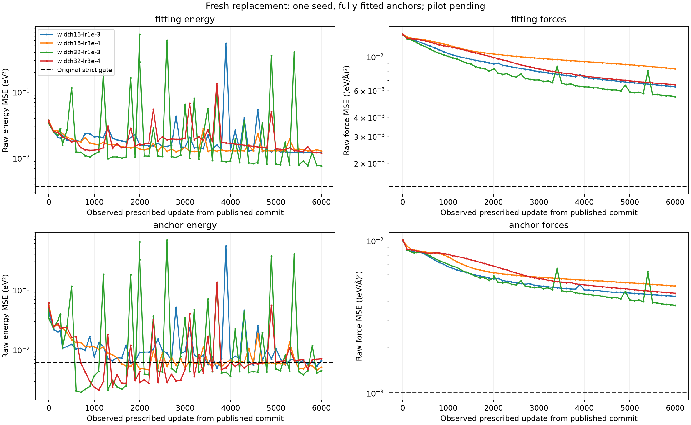

# Fresh replacement width/rate diagnostic

Status: completed; interpretation valid: False; full pilot: pending.

| Cell | Status | Observed persisted update | Fitting E fraction | Fitting F fraction | Fitting joint gate | Anchor joint gate |
|---|---|---:|---:|---:|---|---|
| width16-lr1e-3 | completed | 6000 | 0.3220330430785254 | 0.45318885284127763 | False | False |
| width16-lr3e-4 | completed | 6000 | 0.3419217539400875 | 0.5926503654720645 | False | False |
| width32-lr1e-3 | completed | 6000 | 0.20377621120957126 | 0.3898121837590496 | False | False |
| width32-lr3e-4 | completed | 6000 | 0.3194094334870974 | 0.4657052724792342 | False | False |

Four-cell contrasts available: False.
Measured elapsed seconds: 4295.419170167006.

Every raw/per-group/equal-group/overlap observation, objective, gate, counter, phase time and immutable source identity is retained in the JSON and raw files.

- One seed and fully fitted anchors; no held-out/generalization, capacity or optimizer-causal conclusion.
- Fresh fixed-rate endpoints do not test late-stage rate decay. Width changes initialization shape and optimization geometry.
- Sequential times depend on order, compiler cache and load; no efficiency ranking.
- Original failed trial and zero-update copy stay separate; original unreceipted child effort remains unknown.
- Partial terminal counts are raw claims; known persisted observations and child work require independent saved bindings.
- No automatic winner or full-pilot clearance. All failures and blocked cases stay indexed.

Verification issues:
- Unverified preflight claims quarantined: event:0,event:1,event:2,event:3,event:4,event:5
- Global validity: Preflight receipt mismatch

Historical source hashes identify the original research artifacts. Raw run archives, original launch packages and historical audit records referenced here are retained separately; this report is a research export. See [the reproduction note](../docs/REPRODUCTION.md).
